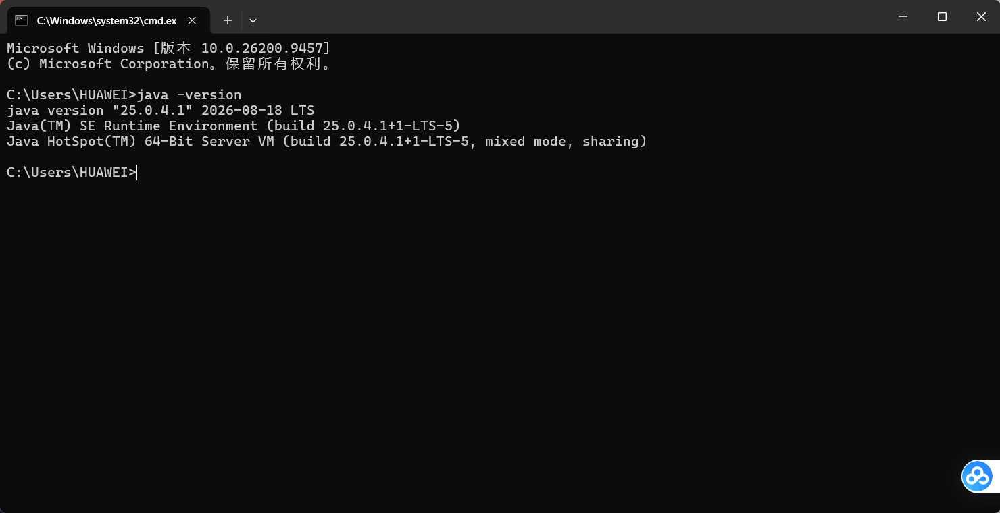
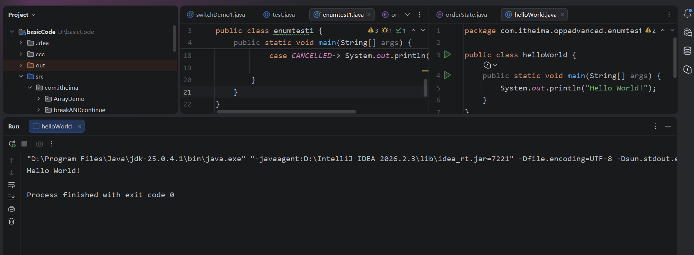
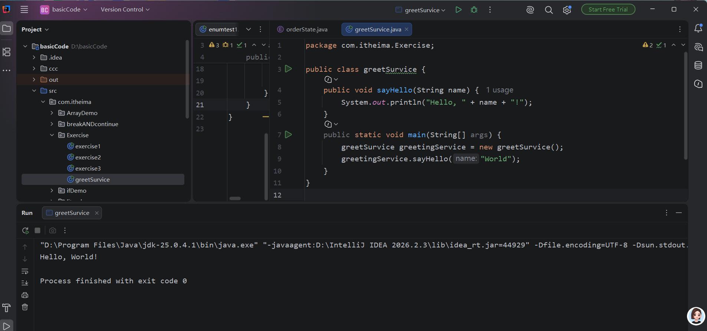

# 环境搭建与程序运行

1. 环境配置

   

   

   

   
   
   


2. helloworld 打印

   

   ```Java
   public static void main(String[] args) {
       System.out.println("Hello World!");
   }
   ```

3. ```java
   public void sayHello(String name) {
       System.out.println("Hello, " + name + "!");
   }
   public static void main(String[] args) {
       GreetingService greetingService = new GreetingService();
       greetingService.sayHello("World");
   }
   ```

