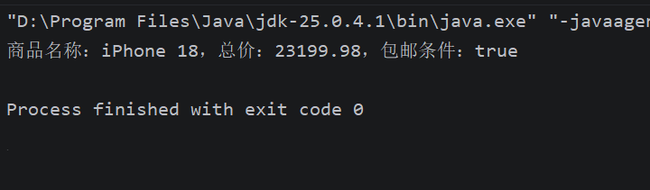
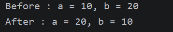

# 数据类型与运算符

1. task1&2


```java
String name = "iPhone 18";
double price = 11599.99;
int stock = 100;
boolean isPromotion = true;
int quantity = 2;
double totalPrice = price * quantity;
boolean isFreeShipping = totalPrice >= 100 || isPromotion;
System.out.println("商品名称：" + name + "，总价：" + totalPrice + "，包邮条件：" + isFreeShipping);
```



1. task3

   ```java
   int a = 10;
           int b = 20;
           System.out.println("Before : a = " + a + ", b = " + b);
           a = a ^ b;
           b = a ^ b;
           a = a ^ b;
           System.out.println("After : a = " + a + ", b = " + b);
   ```

