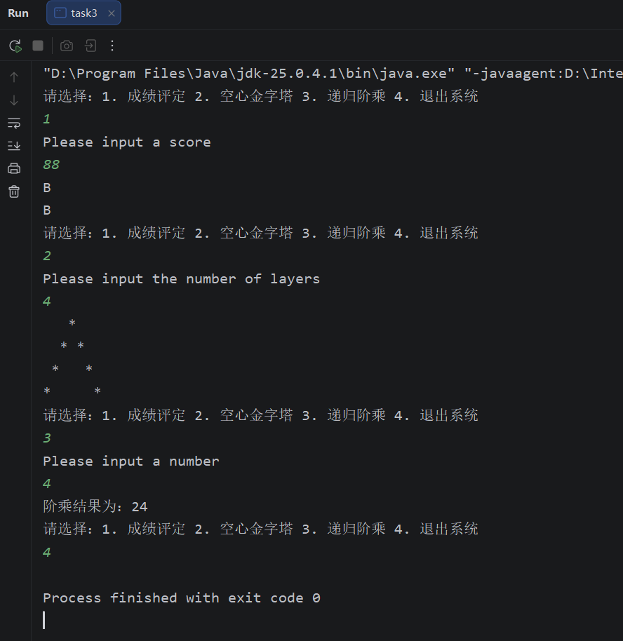

 Task1: 🧭系统菜单与循环控制：使用 `while(true)` 循环打印工具箱菜单（1.成绩评定 2.空心金字塔 3.递归阶乘 4.退出系统）。接收用户输入，当输入4时使用 `break` 跳出循环并结束程序。

    Task2: 📊分支结构闯关（对应菜单1）：输入0-100的分数。请分别使用 `if-else` 区间判断和 `switch` 语句（思考如何利用整数除法取整的特性，如 score/10）实现成绩评定（90+为A，80-89为B，以此类推...），并输出两次判定结果。

    Task3: 🔺循环结构特训（对应菜单2）：输入层数，嵌套使用 `for` 循环，在控制台打印出对应层数的**空心金字塔**图案🔳。需精准判断边界条件：仅在第一行、最后一行、以及每一行的首尾位置打印星号，其余内部位置为空心。

    Task4: 🧮递归思想运用（对应菜单3）：编写一个独立的递归方法 `public int calculateFactorial(int n)` 计算阶乘，并在该分支下调用输出结果。

```java
public static void manu1(){
    System.out.println("Please input a score");
    int score = new java.util.Scanner(System.in).nextInt();
    if(score >= 90){
        System.out.println("A");
    }else if(score >= 80){
        System.out.println("B");
    }else if(score >= 70){
        System.out.println("C");
    }else if(score >= 60){
        System.out.println("D");
    }else{
        System.out.println("E");
    }

    switch (score / 10){
        case 10:
        case 9:
            System.out.println("A");
            break;
        case 8:
            System.out.println("B");
            break;
        case 7:
            System.out.println("C");
            break;
        case 6:
            System.out.println("D");
            break;
        default:
            System.out.println("E");
    }
}
public static void manu2(){
    System.out.println("Please input the number of layers");
    int layers = new java.util.Scanner(System.in).nextInt();
    for (int i = 1; i <= layers; i++) {
        for (int j = 1; j <= layers - i; j++) {
            System.out.print(" ");
        }
        for (int k = 1; k <= 2 * i - 1; k++) {
            if (k == 1 || k == 2 * i - 1) {
                System.out.print("*");
            } else {
                System.out.print(" ");
            }
        }
        System.out.println();
    }
}
public static void manu3(){
    System.out.println("Please input a number");
    int number = new java.util.Scanner(System.in).nextInt();
    System.out.println("阶乘结果为：" + calculateFactorial(number));
}
public static int calculateFactorial(int n) {
    if (n == 0 || n == 1) {
        return 1;
    } else {
        return n * calculateFactorial(n - 1);
    }
}

public static void main(String[] args) {
    while (true) {
        System.out.println("请选择：1. 成绩评定 2. 空心金字塔 3. 递归阶乘 4. 退出系统");
        int choice = new java.util.Scanner(System.in).nextInt();
        if (choice == 1) {
            manu1();
        } else if (choice == 2) {
            manu2();
        } else if (choice == 3) {
            manu3();
        } else if (choice == 4) {
            break;
        }
    }
}
```

